

  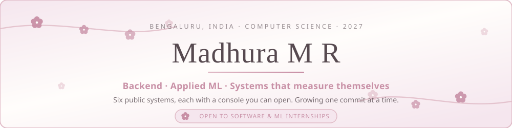

<!-- Prefer your own cherry blossom GIF banner? Swap the line above for:

 -->

  

 

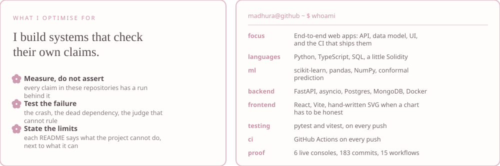

 


  <a href="https://claimkit-sepia.vercel.app/demo"></a>

  <a href="https://madhuuu7.github.io/gridcast/">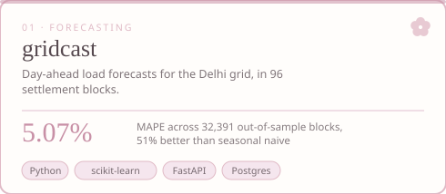</a>
  <a href="https://madhuuu7.github.io/relay-llm-gateway/">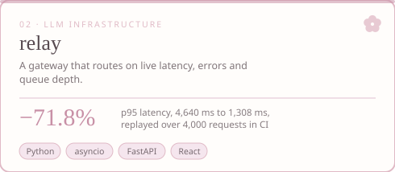</a>

  <a href="https://madhuuu7.github.io/revenant/">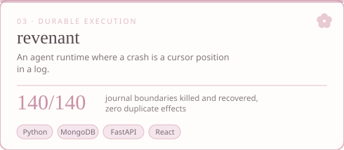</a>
  <a href="https://madhuuu7.github.io/transitlab/">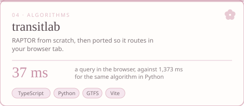</a>

  <a href="https://madhuuu7.github.io/verdict/">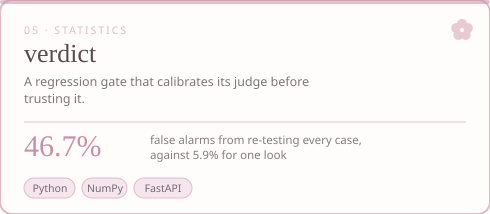</a>
  <a href="https://madhuuu7.github.io/nanofaas/">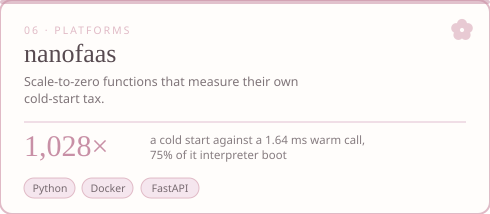</a>

  <b>Open one:</b>
  <a href="https://claimkit-sepia.vercel.app/demo">claimkit</a> ·
  <a href="https://madhuuu7.github.io/gridcast/">gridcast</a> ·
  <a href="https://madhuuu7.github.io/relay-llm-gateway/">relay</a> ·
  <a href="https://madhuuu7.github.io/revenant/">revenant</a> ·
  <a href="https://madhuuu7.github.io/transitlab/">transitlab</a> ·
  <a href="https://madhuuu7.github.io/verdict/">verdict</a> ·
  <a href="https://madhuuu7.github.io/nanofaas/">nanofaas</a>
   
  <b>Read the source:</b>
  <a href="https://github.com/Madhuuu7/claimkit">claimkit</a> ·
  <a href="https://github.com/Madhuuu7/gridcast">gridcast</a> ·
  <a href="https://github.com/Madhuuu7/relay-llm-gateway">relay</a> ·
  <a href="https://github.com/Madhuuu7/revenant">revenant</a> ·
  <a href="https://github.com/Madhuuu7/transitlab">transitlab</a> ·
  <a href="https://github.com/Madhuuu7/verdict">verdict</a> ·
  <a href="https://github.com/Madhuuu7/nanofaas">nanofaas</a>

  
  
  
  
  
  
  
   
  Live workflow status, not decoration — these go red when a test breaks.

  Two more, from before these:
  <a href="https://github.com/Madhuuu7/blockchain-based-evidence-system"><b>a blockchain evidence system</b></a>
  — chain of custody on Sepolia, 193 tests ·
  <a href="https://github.com/Madhuuu7/Distributed-Cloud-IDE"><b>a browser IDE with an AI teammate</b></a>
  — Monaco over a hardened Docker sandbox

 

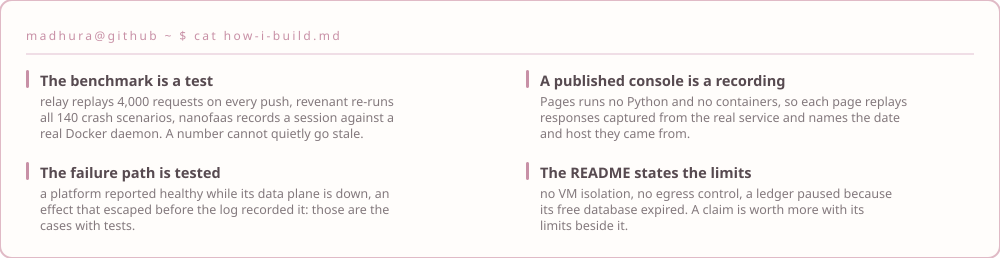

 

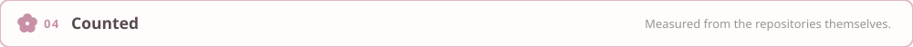

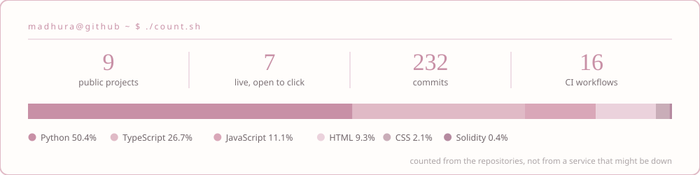

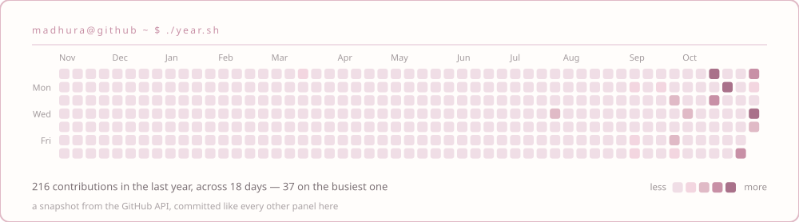

  
  
  
  
  
  
   
  
  
  
  
  
  
  
  

 

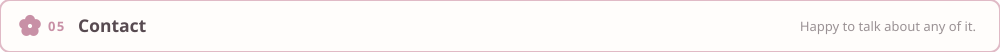

  
  
  
  

<!-- A cute coding/coffee illustration fits nicely here:

 -->

  

  

<!-- Falling petals GIF, if you find one you like:

 -->
