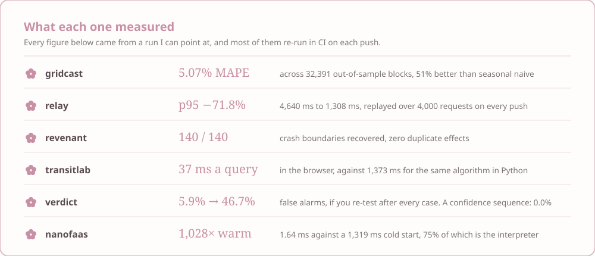
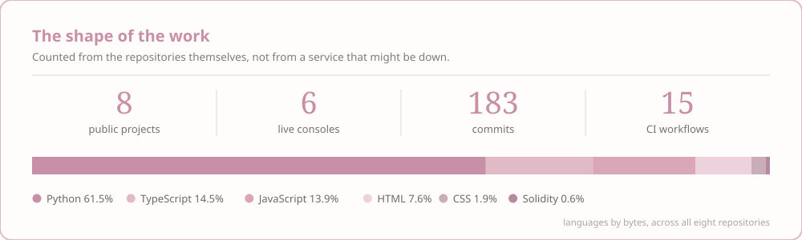

  

<!-- Prefer your own cherry blossom GIF banner? Swap the line above for:

 -->

  

  

🌸 ･ ﾟ ✧ ･ ﾟ 🌸

## 🌷 About

- 🎓 Computer science undergraduate, graduating **2027**, looking for a software or ML engineering internship.
- 🌱 I build **six public systems**, each with a console you can open and a benchmark that re-runs in CI.
- 📐 My habit: measure the thing rather than assert it — and write down what the project *cannot* do, next to what it can.
- 🍃 Mostly **Python** and **TypeScript**, with a soft spot for the part where a claim gets tested.

🌸 ･ ﾟ ✧ ･ ﾟ 🌸

## ✨ What the work measured

  

  
  
  
  
  
  

Live status, not a decoration — these go red if a test breaks.

🌸 ･ ﾟ ✧ ･ ﾟ 🌸

## 🌸 Featured projects

<i>Like a cup of coffee, every great idea starts with a little spark ☕</i>

<table>
<tr>
<td width="50%" valign="top">

### 🌷 [gridcast](https://github.com/Madhuuu7/gridcast)

Day-ahead load forecasting for the Delhi grid, on three years of real SLDC readings. The point forecast is table stakes; the product is a **prediction interval whose coverage is measured, not assumed**.

`Python` · `scikit-learn` · `FastAPI` · `PostgreSQL` · `React`

**[Open the desk →](https://madhuuu7.github.io/gridcast/)**

</td>
<td width="50%" valign="top">

### 🌷 [relay](https://github.com/Madhuuu7/relay-llm-gateway)

An LLM gateway that picks a provider from **live latency, error rate and queue depth** instead of a static fallback list. Point an OpenAI client at it and it gains fail-over and cost accounting.

`Python` · `FastAPI` · `asyncio` · `React` · `TypeScript`

**[Open the console →](https://madhuuu7.github.io/relay-llm-gateway/)**

</td>
</tr>
<tr>
<td width="50%" valign="top">

### 🌷 [revenant](https://github.com/Madhuuu7/revenant)

A durable agent runtime where a crash is just a cursor position in an append-only log. **Killed at all 140 journal boundaries**; all 140 recover with identical output and no duplicate effects.

`Python` · `FastAPI` · `MongoDB` · `React` · `TypeScript`

**[Open the crash matrix →](https://madhuuu7.github.io/revenant/)**

</td>
<td width="50%" valign="top">

### 🌷 [transitlab](https://github.com/Madhuuu7/transitlab)

RAPTOR implemented from scratch over real GTFS data, then ported to TypeScript so **the routing runs in your tab** — Bengaluru's 9,948 stops, no server behind the page.

`Python` · `TypeScript` · `GTFS` · `Vite`

**[Plan a journey →](https://madhuuu7.github.io/transitlab/)**

</td>
</tr>
</table>

  Two more: <b><a href="https://github.com/Madhuuu7/verdict">verdict</a></b>, a regression gate for LLM pipelines that calibrates its judge before trusting it ·
  <b><a href="https://github.com/Madhuuu7/nanofaas">nanofaas</a></b>, a scale-to-zero function platform that measures its own cold-start tax

<b>🌸 How these are built</b> — four habits that repeat across all six

 

- **The benchmark is a test.** relay replays its 4,000-request trace on every push, revenant re-runs all 140 crash scenarios, nanofaas records a fresh session against a real Docker daemon, and transitlab fails the build if the browser port's answers drift from the Python implementation's. A number cannot quietly go stale.
- **A deployed console is a recording, and says so.** GitHub Pages runs no Python and no containers. Rather than mock a backend, each page replays responses captured from the real service and names the date and host they came from — so what you read is a measurement, not a drawing of one.
- **The failure path is tested, not only the happy one.** A platform reported as healthy while its data plane is down, a gate that cannot rule, an effect that escaped before the log recorded it: those are the cases with tests.
- **The README says what the project cannot do.** No VM isolation, no egress control, a ledger that is paused because its free database expired. A claim is worth more when the limits are stated next to it.

🌸 ･ ﾟ ✧ ･ ﾟ 🌸

## 🍃 Tech I reach for

  
  
  
  
  
  
   
  
  
  
  
  
  

🌸 ･ ﾟ ✧ ･ ﾟ 🌸

## 📊 Stats

  

Counted from the repositories, so it cannot break when someone else's free tier does.

🌸 ･ ﾟ ✧ ･ ﾟ 🌸

## ☕ Currently

- 🌱 **Building** — a portfolio site to tie the six together
- 📖 **Reading** — the papers these came out of: RAPTOR, conformal prediction, confidence sequences
- 🔭 **Next** — more of the systems side: schedulers, storage, and things that have to survive being killed
- ☕ **Drinking** — coffee, mostly

🌸 ･ ﾟ ✧ ･ ﾟ 🌸

## 💌 Let's connect

  
  
  

<!-- A cute coding/coffee illustration fits nicely here:

 -->

  

<!-- Falling petals GIF, if you find one you like:

 -->
